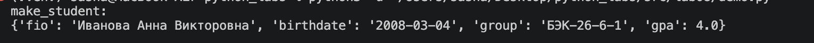
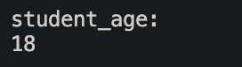
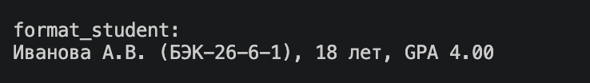
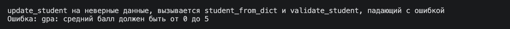
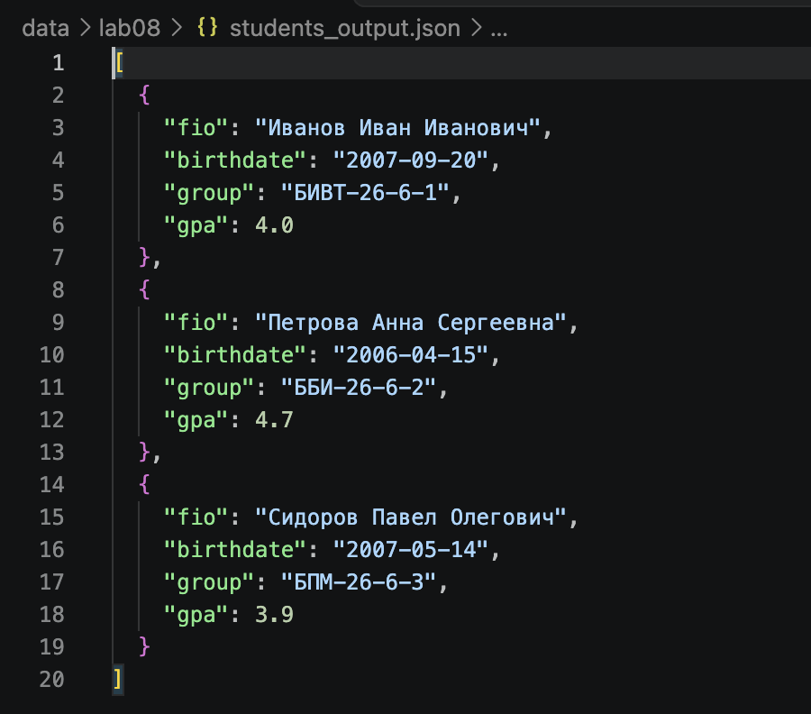
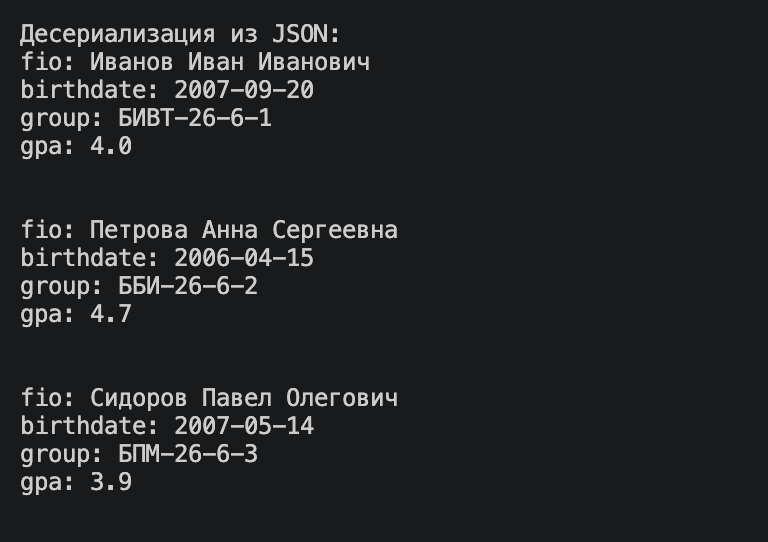
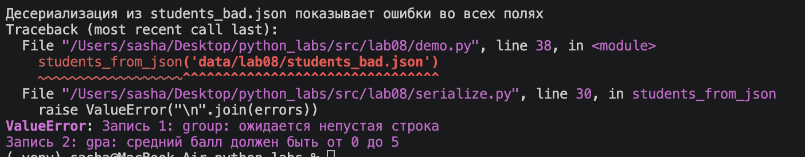
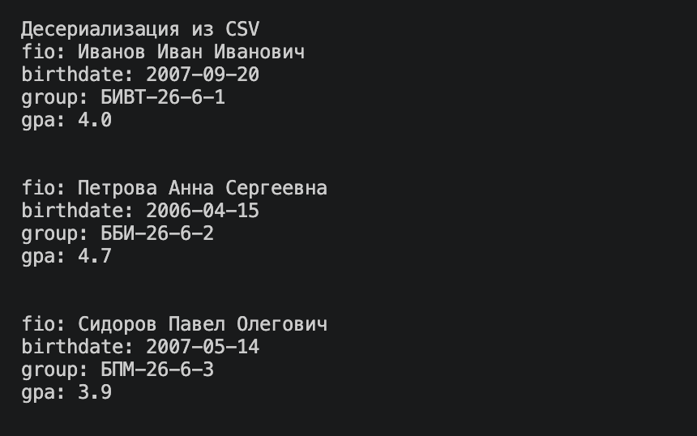

# ЛР8 – Модель данных без классов: запись Student как словарь, валидация и сериализация

## Структура записи Student
Студент представлен обычным словарём. Допустимые ключи перечислены в константе:

```python
STUDENT_FIELDS = ("fio", "birthdate", "group", "gpa")
```

| Поле | Тип | Условия |
| --- | --- | --- |
| `fio` | `str` | Непустая строка после `strip()` |
| `birthdate` | `str` | Существующая дата строго в формате `YYYY-MM-DD`, не в будущем |
| `group` | `str` | Непустая строка после `strip()` |
| `gpa` | `float` | Число от 0 до 5 включительно; входной `int` преобразуется в `float`, `bool` запрещён |

Пример записи:

```python
{
    "fio": "Иванов Иван Иванович",
    "birthdate": "2007-09-20",
    "group": "БИВТ-26-6-1",
    "gpa": 4.3,
}
```

Набор ключей должен в точности совпадать с `STUDENT_FIELDS`. Порядок ключей при проверке значения не имеет.

## Реализация models.py

### make_student(fio, birthdate, group, gpa)
Функция собирает словарь и вызывает `validate_student`. После успешной проверки удаляет пробелы по краям `fio` и `group`, преобразует `gpa` в `float` и возвращает новую запись.


### validate_student(rec)
Функция проверяет, что передан словарь и набор его ключей точно соответствует модели. Далее проверяет тип и содержимое каждого поля. При корректных данных возвращает `None`, при ошибке вызывает `ValueError` с пояснением.

### student_age(rec, today=None)
Функция проверяет запись, разбирает дату рождения и вычисляет разность годов. Если текущие месяц и день меньше месяца и дня рождения, вычитает единицу. Параметр `today` позволяет задать дату расчёта объектом `date`, по умолчанию используется сегодняшний день. Дата расчёта раньше рождения вызывает `ValueError`.


### format_student(rec)
Функция вычисляет возраст, выделяет первое слово ФИО как фамилию и преобразует остальные слова в инициалы. Группа выводится в скобках, а средний балл - с двумя знаками после десятичной точки.


### student_to_dict(rec)
Функция проверяет запись и возвращает новый словарь с теми же полями и значениями. Это отдельный объект: изменение копии не меняет исходную запись. Поверхностного копирования достаточно, поскольку все значения полей имеют неизменяемые типы.

### student_from_dict(d)
Функция проверяет входной словарь и передаёт его поля в `make_student`. Возвращается новая нормализованная запись с `gpa` типа `float`. Пропущенные или лишние ключи отклоняются. Строковый средний балл здесь не принимается: преобразование строк из CSV выполняется отдельно.

### ★ update_student(rec, **fields)
Функция получает проверенную копию исходной записи, проверяет имена обновляемых полей, добавляет новые значения и создаёт запись через `student_from_dict`. Неизвестное имя поля вызывает `KeyError`, неверное значение - `ValueError`. Исходная запись сохраняет прежние значения.


## Реализация serialize.py

### students_to_json(students, path)
Каждая запись проверяется и копируется через `student_to_dict`. Полученный список записывается в файл в кодировке UTF-8. Параметр `ensure_ascii=False` сохраняет русские буквы в читаемом виде, `indent=2` задаёт отступы. JSON содержит массив объектов.


### students_from_json(path)
Функция читает JSON и проверяет, что верхний уровень - список. Каждый элемент передаётся в `student_from_dict`. При успешной обработке возвращается список записей студентов.



### Политика обработки битых записей
Выбрана политика **strict**. Первая неверная запись останавливает импорт: функция вызывает `ValueError`, указывая номер записи, начиная с 1, и причину ошибки. Частичный список не возвращается, неверные данные не пропускаются молча.

### ★ students_from_csv(path) — дополнительное задание
Файл открывается в UTF-8 с `newline=""`, строки читает `csv.DictReader`. Проверяется набор заголовков `fio,birthdate,group,gpa`. Значения из CSV поступают строками. Поэтому непосредственно внутри `students_from_csv` до вызова `student_from_dict` GPA преобразуется во `float`. Остальные проверки выполняет модель. При неверной записи применяется `strict` с указанием номера записи данных без учёта строки заголовка.


