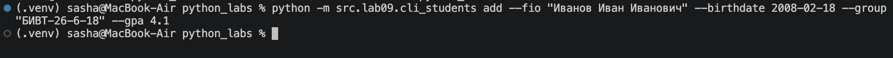
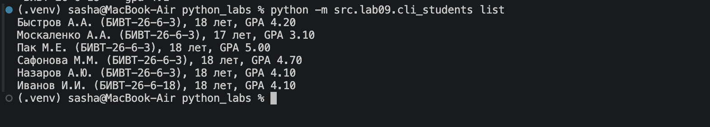
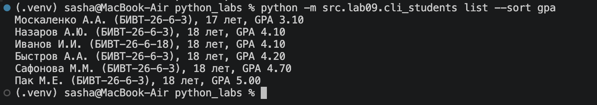
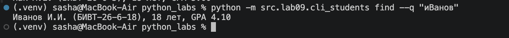
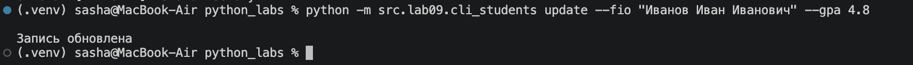
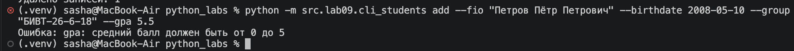

# ЛР9 — «База данных» на CSV

## Результаты

В `group.py` реализованы функции для работы с CSV-хранилищем студентов. Каждая функция получает путь к файлу первым аргументом. Запись студента представлена словарём с полями `fio`, `birthdate`, `group` и `gpa`. Для проверки данных используется модель из ЛР8.

| Функция | Что делает |
| --- | --- |
| `ensure_storage(path)` | Создаёт CSV с заголовком `fio,birthdate,group,gpa`, если файла ещё нет. |
| `load_students(path)` | Читает CSV через `csv.DictReader`, проверяет заголовок и записи, преобразует GPA в число. При отсутствии файла возвращает пустой список. |
| `save_students(path, students)` | Проверяет записи, записывает их через `csv.DictWriter` во временный CSV рядом с основным и после закрытия файла заменяет им основной через `Path.replace()`. |
| `add_student(path, student)` | Добавляет студента в конец списка. Повторное ФИО вызывает `ValueError`. |
| `list_students(path, sort_by=None)` | Возвращает записи в порядке файла или сортирует их по ФИО либо по GPA по возрастанию. |
| `find_students(path, substr)` | Ищет подстроку в ФИО без учёта регистра. |
| `update_student(path, fio, **fields)` | Обновляет первую запись с указанным ФИО и возвращает `True`. Если запись не найдена, возвращает `False`. Неизвестное поле вызывает `KeyError`. |
| `remove_student(path, fio)` | Удаляет все записи с указанным ФИО и возвращает их количество. |

В `cli_students.py` подкоманды разбираются через `argparse`. По умолчанию используется файл `data/lab09/students.csv`. Параметр `--db` указывается перед подкомандой и позволяет выбрать другой файл. Команды `list` и `find` выводят записи через `format_student` из ЛР8.

### 1. Добавление студента

```bash
python -m src.lab09.cli_students add --fio "Иванов Иван Иванович" --birthdate 2008-02-18 --group "БИВТ-26-6-18" --gpa 4.1
```

Команда завершается с кодом 0 и без вывода. Новая запись видна в следующей команде.



### 2. Вывод списка в порядке файла

```bash
python -m src.lab09.cli_students list
```



### 3. Сортировка по среднему баллу

```bash
python -m src.lab09.cli_students list --sort gpa
```



### 4. Поиск по части ФИО

```bash
python -m src.lab09.cli_students find --q "иВанов"
```


### 5. Обновление среднего балла

```bash
python -m src.lab09.cli_students update --fio "Иванов Иван Иванович" --gpa 4.8
```



### 6. Удаление записи

```bash
python -m src.lab09.cli_students remove --fio "Назаров Александр Юрьевич"
```


## Проверка неверного GPA

```bash
python -m src.lab09.cli_students add --fio "Петров Пётр Петрович" --birthdate 2008-05-10 --group "БИВТ-26-6-18" --gpa 5.5
```



## Итоговый students.csv

```csv
fio,birthdate,group,gpa
Быстров Артём Алексеевич,2008-03-06,БИВТ-26-6-3,4.2
Москаленко Александра Александровна,2009-03-06,БИВТ-26-6-3,3.1
Пак Михаил Евгеньевич,2008-01-30,БИВТ-26-6-3,5.0
Сафонова Марина Максимовна,2008-03-23,БИВТ-26-6-3,4.7
Иванов Иван Иванович,2008-02-18,БИВТ-26-6-18,4.8
```
